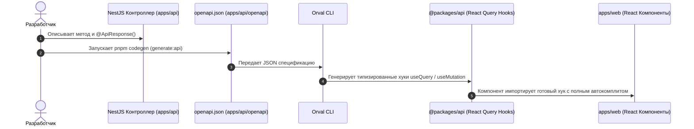

# ⚡ Конвейер API Кодогенерации (NestJS ➔ OpenAPI ➔ Orval ➔ TanStack Query)

В проекте CollabBoard используется современный **Contract-First подход** взаимодействия между бэкендом и фронтендом.

---

## 🎯 Главная цель конвейера

1. ❌ **Никакого ручного написания fetch-запросов на фронтенде.**
2. ❌ **Никакого дублирования интерфейсов и типов данных между `apps/api` и `apps/web`.**
3. ✅ **100% Type-Safety:** если бэкенд изменил структуру ответа или обязательное поле, фронтенд не скомпилируется (`pnpm typecheck` сразу подсветит ошибку до выкатки в прод).

---

## 🔄 Архитектурный поток (Pipeline Flow)



---

## 🚀 Пошаговое руководство: «Как добавить новый API-метод за 3 шага»

### Шаг 1. Опишите DTO в `@packages/dto` (если требуется валидация)
В файле `packages/dto/src/index.ts`:
```typescript
import { z } from "zod";

export const CreateBoardSchema = z.object({
  title: z.string().min(1, "Название доски обязательно"),
  workspaceId: z.string().uuid(),
});

export type CreateBoardDto = z.infer<typeof CreateBoardSchema>;
```

---

### Шаг 2. Создайте эндпоинт в NestJS контроллере
В файле `apps/api/src/modules/boards/boards.controller.ts`:
```typescript
import { Body, Controller, Post } from "@nestjs/common";
import { ApiOperation, ApiResponse, ApiTags } from "@nestjs/swagger";
import { CreateBoardDto } from "@packages/dto";
import { BoardsService } from "./boards.service";

@ApiTags("Boards")
@Controller("boards")
export class BoardsController {
  constructor(private readonly boardsService: BoardsService) {}

  @Post()
  @ApiOperation({ summary: "Создание новой доски" })
  @ApiResponse({ status: 201, description: "Доска успешно создана" })
  createBoard(@Body() dto: CreateBoardDto) {
    return this.boardsService.create(dto);
  }
}
```

> 💡 **Важно для Swagger и NestJS:** NestJS reflection строит OpenAPI-схемы на основе TypeScript классов и декораторов `@ApiProperty()`. Для тел запросов и ответов в модуле создается DTO-класс с аннотациями Swagger (см. эталонный пример `HealthResponseDto`), а Zod-схема из `@packages/dto` обеспечивает валидацию данных.

---

### Шаг 3. Запустите генерацию в терминале
Выполните команду в корне проекта:
```bash
pnpm codegen
```

**Что происходит под капотом:**
1. Запускается `ts-node scripts/generate-openapi.ts` — NestJS поднимается в памяти без HTTP-сервера и мгновенно сохраняет актуальную схему в `apps/api/openapi/openapi.json`.
2. Запускается `orval --config ./orval.config.ts` — Orval читает схему, разделяет эндпоинты по тегам (`tags-split`) и создает хуки в:
   `packages/api/src/generated/endpoints/boards/boards.ts` (доступны через общий импорт из `@packages/api`).

---

### Шаг 4. Используйте сгенерированный хук на фронтенде (`apps/web`)
В любом компоненте `apps/web`:
```tsx
"use client";

import { useBoardsControllerCreateBoard } from "@packages/api";
import { useState } from "react";

export function CreateBoardButton() {
  const [title, setTitle] = useState("");
  
  // Типизированный мутатор TanStack Query сгенерирован автоматически!
  const createBoardMutation = useBoardsControllerCreateBoard({
    mutation: {
      onSuccess: (newBoard) => {
        console.log("Доска создана:", newBoard.id);
      },
    },
  });

  const handleCreate = () => {
    createBoardMutation.mutate({
      data: {
        title,
        workspaceId: "some-uuid",
      },
    });
  };

  return (
    <button
      onClick={handleCreate}
      disabled={createBoardMutation.isPending}
      className="bg-primary text-primary-foreground px-4 py-2 rounded-md"
    >
      {createBoardMutation.isPending ? "Создание..." : "Создать доску"}
    </button>
  );
}
```

---

## 🛠 Сетевой транспорт (`packages/api/src/transport.ts`)

Orval не выполняет запросы сам — он делегирует их кастомному транспорту `customInstance` в `packages/api/src/transport.ts`.

Особенности транспорта:
- Автоматически подставляет базовый URL (`NEXT_PUBLIC_API_URL` или `http://localhost:3001`).
- Автоматически проставляет `credentials: "include"`, чтобы сессионные куки передавались с каждым запросом.
- Корректно сериализует query-параметры и JSON-тела.
- При ошибках выбрасывает понятный `Error` с сообщением от бэкенда.
